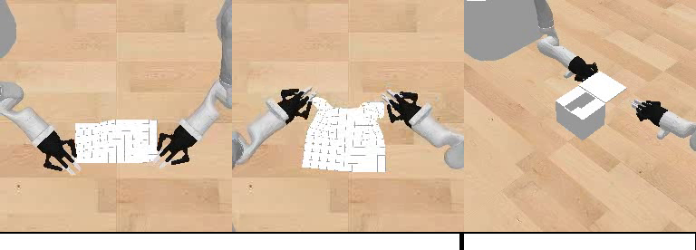

# SO(3)-Equivariant Transformer for Robot Manipulation Policy

基于点云的等变 Transformer 机器人操作策略：严格复现、架构消融、分布外泛化、
位姿精度、等变性、效率和重建仿真的可审计实验记录。

> **Repository scope.** 本仓库是公开实验主页，不是训练代码发布。页面中的数值来自
> 已完成实验及冻结工件；图片直接复用对应仿真实验输出，没有为本主页重新生成结果图。
> checkpoint、原始数据、私有运行路径以及 `e2tsp-escnn` 实现源码不在公开范围内。

## 三条研究经历

- **EquiBot / SO(3)-equivariant encoder ablation.** 严格复现 EquiBot 与 vanilla
  Diffusion Policy，设计并训练 E2-Linear-K8：以 4-layer ESCNN SO(3) local-attention
  encoder 替换 VN-PointNet，保持 EquiBot canonicalization、vector diffusion head、
  训练数据和预算不变。完成 2,000 epochs / 120,000 steps 训练、actor/EMA strict-load
  审计，以及 40 对逐场景一致的 OOD rollout。E2 保持 Original reward
  (`0.987269` vs. DP `0.987363`)，将三个 OOD 设置的平均 reward 从 `0.040051`
  提升到 `0.925496`；四设置 macro paired delta 为 `+0.664060`，95% bootstrap CI
  `[+0.516306, +0.808862]`。
- **RiEMann / SE(3)-equivariant policy reproduction and efficiency study.** 完成
  B0/M1/M2 三模型、三训练 seed、Phi/Manipulation 两阶段共 18 个正式训练阶段，审计
  36 个 checkpoint，并执行 360 个 held-out 位姿预测、486 个等变性 case、3,600 次
  CUDA 同步计时和 900 个配对 SAPIEN 代理 episode。M2 将参数量降低 `98.24%`，取得
  `5.556x` model-only 和 `3.628x` end-to-end 加速，但旋转误差升至 `60.346 deg`；
  M1 在重建代理基准达到 `67.0%` 总体成功率，比 B0 高 `12.7 pp`，由此定位
  type-1 / rotation 分支是轻量化的主要质量瓶颈。
- **WAM 与真机路线（规划中）。** 规划把等变 Transformer 应用到最新范式
  World-Action Model（WAM）上，先验证几何等变表征与 world/action token 交互在仿真
  中的稳定性、时延和 OOD 泛化，再在 i2RT 上尝试真机推理实验。该项是研究计划，
  尚无结果，不与前两项已完成实验混写。WAM 背景参考
  [OpenWAM](https://openwam.stanford.edu/)。

## 项目概览

两条实验线回答互补问题：

| 实验线 | 研究问题 | 任务与证据 | 当前结论 |
|---|---|---|---|
| EquiBot E2 | 等变完整系统能否提高尺度、旋转、位置 OOD 鲁棒性？ | Object Covering；DP/E2 各 40 episodes，40/40 场景精确配对 | seed-0 pilot 中 OOD 优势强；尚不是多 seed 正式结论 |
| RiEMann B0/M1/M2 | 等变 Transformer 的几何核复用能否降低时延和显存，同时保持质量？ | 3 seeds；360 位姿预测、486 等变 case、3,600 次计时、900 代理仿真 episodes | M2 速度/显存最佳但方向质量退化；M1 代理成功率最高 |
| WAM roadmap | 等变几何先验能否进入联合 world/action prediction？ | 计划：仿真 -> i2RT 真机 | 未执行，不报告结果 |

这里的群作用层次不同：SO(3) 描述旋转，SE(3) 进一步包含平移，SIM(3) 再包含尺度。
本项目关注的是 SO(3)-equivariant Transformer 模块如何嵌入 SE(3)/SIM(3) 机器人策略，
而不是把三种群视为同一个实验设置。

## 1. EquiBot：E2-Linear-K8

### 1.1 仿真任务

以下是本地冻结 EquiBot baseline 的实际 rollout，依次为 Cloth Folding、Object
Covering 和 Box Closing。本轮 E2 训练与严格配对比较只使用 **Object Covering**。



实验建立在 [EquiBot](https://github.com/yjy0625/equibot) 的公开环境、数据生成流程和
评测接口上。cover 数据包含 50 demonstrations、1,948 个时间步；原始点云每帧
4,096 点，训练时随机/打乱后使用 1,024 点。所有比较均使用相同冻结数据，且
`num_augment=0`。

### 1.2 架构设计与控制变量

E2 是相对官方 EquiBot E0 的 **encoder-only ablation**：

| 组件 | 官方 E0 | E2-Linear-K8 | 是否改变 |
|---|---|---|---|
| 点云 encoder | 4-layer VN-PointNet | 4-layer ESCNN SO(3) local-attention encoder | 是 |
| 图结构 | kNN, K=8 | kNN, K=8 | 否 |
| equivariant Q/K/V | VN 内部结构 | linear Q/K/V | 主变量 |
| embedding irreps | VN vector features | `l=1:64`, `l=2:64` | 主变量 |
| Q/K irreps | 不适用 | `l=1:32`, `l=2:32` | 主变量 |
| attention | local kNN | 8 heads，irrep 内 dot product + distance bias | 主变量 |
| policy canonicalization | SIM(3) center/scale | 相同 | 否 |
| diffusion head | vector Conditional U-Net | 相同 | 否 |
| actor/EMA/checkpoint API | 官方 EquiBotAgent | 相同，默认 strict load | 否 |

E2 输出保持官方 `center / scale / so3 / inv` 的 shape、dtype 和 device contract；训练
与评测没有使用 `strict=False`。E0 为 `124,637,522` 个可训练参数，E2 为
`124,625,778`，差异仅 `-0.0094%`。

vanilla DP 对照则是完整系统对照：它使用 scalar PointNetEncoder、scalar
Conditional U-Net，并且不走 EquiBot 的 SIM(3) policy canonicalization。因此
**DP vs. E2 可以验证完整等变系统，但不能把收益单独归因于 encoder**。

### 1.3 冻结训练协议

| 参数 | Vanilla DP | 官方 E0 | E2 |
|---|---:|---:|---:|
| task / training seed | cover / 0 | cover / 0 | cover / 0 |
| epochs / optimizer steps | 2,000 / 120,000 | 2,000 / 120,000 | 2,000 / 120,000 |
| batch size / workers | 32 / 12 | 32 / 12 | 32 / 12 |
| learning rate / weight decay | `3e-5` / `1e-6` | 相同 | 相同 |
| point count / hidden dim | 1,024 / 128 | 相同 | 相同 |
| encoder layers | 4 | 4 | 4 |
| obs / pred / action horizon | 2 / 16 / 8 | 相同 | 相同 |
| DDPM | 100 steps, epsilon prediction | 相同 | 相同 |
| inline evaluation / compile | 关闭 / 关闭 | 相同 | 相同 |

硬件为 NVIDIA L20Z。DP、E0、E2 的完整 2,000-epoch 训练时间分别为 `1:08:28`、
`9:03:35`、`39:26:01`；E2 相对 E0 慢 `4.35x`，相对 DP 慢 `34.56x`。E2 峰值显存
为 `19,151 MiB`。训练代价主要来自 irreps、basis expansion 与等变线性/注意力算子，
而不是全局点云注意力：E2 使用的是 K=8 local kNN graph。

### 1.4 严格配对评测

评测冻结为 cover / training seed 0 / `ckpt01999`，四个 setup 各 10 episodes：

- Original：不覆盖原始位置、尺度和旋转；
- R+Su：z 轴旋转 + `[1,2]` uniform scale；
- R+Sn：z 轴旋转 + `[1,2]` nonuniform scale，aspect ratio 上限 1.33；
- R+Sn+P：R+Sn + xy Gaussian position offset，`rand_pos_scale=0.5`。

DP 和冻结 E2 工件在 40 对 episode 上满足：initial state 40/40、randomization
40/40、initial point cloud 40/40 逐元素相同。训练 seed 与 inference seed 均为 0，
environment seeds 为 0..9。审计重新加载了 80 个 NPZ，并用 ffprobe 验证了 80 个
MP4；paired bootstrap 固定 seed `20261027`，执行 100,000 次重采样。


| setup | DP reward mean +/- pop std | DP success | E2 reward mean +/- pop std | E2 success | E2-DP | paired 95% CI |
|---|---:|---:|---:|---:|---:|---:|
| Original | 0.987363 +/- 0.007382 | 100% | 0.987269 +/- 0.007926 | 100% | -0.000094 | [-0.005829, +0.005487] |
| R+Su | 0.007420 +/- 0.018566 | 0% | 0.993273 +/- 0.006477 | 100% | +0.985852 | [+0.973587, +0.994892] |
| R+Sn | 0.099644 +/- 0.294074 | 10% | 0.986715 +/- 0.012242 | 100% | +0.887071 | [+0.687928, +0.991957] |
| R+Sn+P | 0.013087 +/- 0.026285 | 0% | 0.796499 +/- 0.398265 | 80% | +0.783412 | [+0.492443, +0.986028] |
| **四设置 macro** | **0.276879** | - | **0.940939** | - | **+0.664060** | **[+0.516306, +0.808862]** |

三个 OOD 设置的等权均值为 DP `0.040051`、E2 `0.925496`。Original-R+Sn+P gap
对应提升 `+0.885445`；Original-R+Sn+P gap 从 DP 的 `0.974276` 降到 E2 的
`0.190770`。Original 的区间跨 0，说明当前样本中 E2 没有可见的 in-distribution
损失；三个 OOD setup 的 paired delta 则均为正。

### 1.5 失败案例

R+Sn+P 中 E2 在 environment seed 2 和 6 失败，在 seed 9 成功：

| seed 2：失败 | seed 6：失败 | seed 9：成功参考 |
|---|---|---|
|  |  |  |

seed 2/6 是该批 E2 样本中位置偏移最大的两个场景，offset norm 分别为 `1.123765`
和 `1.349614`；其余 8 个场景的 offset norm 不超过 `0.837757` 且全部成功。严格配对
DP 在 seed 2/6 同样失败，并且其余 8 个 R+Sn+P 场景也全部低于 success threshold，
所以系统差异不能由场景难度不一致解释。

### 1.6 能够与不能够得出的结论

**能够得出：** 在 seed-0 / 单 checkpoint / 40 对完全相同场景的 pilot 范围内，完整
E2 等变系统保持 Original 性能，并显著提高 rotation/scale/position OOD reward。

**不能得出：** 这不是三训练 seed、最后五 checkpoint 的正式统计，也不能分离
ESCNN encoder、SIM(3) canonicalization 和 vector diffusion head 的独立贡献。E0/E2
encoder-only pilot 因环境 reset 次序不同，只能作为描述性对照。下一项有效因果实验应
冻结 E2 encoder、数据、canonicalization、动作表示和预算，只替换 diffusion head，
并显式记录 vector-to-scalar adapter。

## 2. RiEMann：B0 / M1 / M2

### 2.1 复现与消融目标

该实验建立在 [RiEMann](https://github.com/HeegerGao/RiEMann) 公开实现之上，研究
SE(3)-equivariant policy 的精度、等变性和效率权衡。统一预测链为：Phi saliency
center -> ROI 1 -> psi1 translation -> psi2 type-1 vectors -> ROI 2 pooling ->
modified Gram-Schmidt rotation。


> 上图直接复用 RiEMann 官方 MIT-licensed repository 的 `web_teaser.gif`，仅用于说明
> 原方法的任务形式；本仓库的定量结果来自下述本地复现与重建代理基准。

### 2.2 三个模型

| 模型 | 主干定义 | 参数量 | 相对 B0 参数缩减 |
|---|---|---:|---:|
| B0 | 官方 RiEMann SE(3)-Transformer | 736,340 | 0% |
| M1 | 每层 relative-edge equivariant Transformer | 93,706 | 87.27% |
| M2 | 一次 relative-edge geometry lift；后续 equivariant linear Q/K/V + local invariant attention | 12,955 | 98.24% |

M2 的核心计算假设是把昂贵的逐层 steerable edge kernel 限制到首次 geometry lift，
后续层复用已经提升的等变特征。实验结果表明这一设计确实降低时延和显存，但其
type-1 / rotation 分支没有保持 B0 的方向质量。

### 2.3 冻结训练协议

| 参数 | 设置 |
|---|---|
| 模型 / seeds | B0、M1、M2；training seeds 0、1、2 |
| 两阶段训练 | 每个 seed 先 Phi，再训练 Manipulation (`psi1/psi2`) |
| 输入点数 / batch | 2,500 / 1 |
| 数据划分 | trajectory-level 8 train / 2 validation，避免相邻帧泄漏 |
| Phi | 200 epochs，Adam LR `1e-3` |
| Manipulation | 500 epochs，Adam LR `5e-4` |
| scheduler | StepLR；Phi 40 epochs x 0.5，Mani 166 epochs x 0.5 |
| precision | FP32，无 BF16/AMP |
| checkpoint | 每个模型/seed 使用各自 best；同 seed Phi 只传递给同 seed Mani |
| ROI | Mani train/validation 使用 GT center；正式推理使用同 seed Phi predicted center |

18 个正式阶段全部到达 Phi epoch 199 或 Mani epoch 499。三 seed 平均每 epoch：B0
Phi/Mani `92.817/49.076 s`，M1 `134.449/81.818 s`，M2 `31.066/46.830 s`。

### 2.4 离线评测协议

- 位姿精度：每个模型/seed 使用 2 条 held-out trajectories，共 40 帧；完整 predicted
  Phi -> Psi 链，不用 GT center 替代预测 center。
- 等变性：每个模型/seed 对 18 个输入分别执行全局旋转、全局平移和点置换，共
  486 cases。
- 效率：单张 L20Z、batch 1、2,500 点；warm-up 10 次后 CUDA synchronize 计时
  200 次；model-only 与 end-to-end 各计 1,800 次。
- 显著性：同 seed、同 repeat 配对；汇总 600 对，bootstrap 10,000 次。
- 统计单位：跨模型结论以三个独立训练 seed 为单位，不把相邻视频帧当成独立训练重复。

| 模型 | translation error cm | rotation error deg | model-only p50 ms | end-to-end p50 ms | peak memory MiB |
|---|---:|---:|---:|---:|---:|
| B0 | **0.7237** | **6.514** | 230.977 | 240.816 | 18,125.1 |
| M1 | 0.7979 | 12.220 | 305.014 | 324.981 | 2,168.7 |
| M2 | 1.5482 | 60.346 | **40.841** | **66.201** | **441.1** |

| Accuracy | Equivariance |
|---|---|
|  |  |
|  |  |

相对 B0，M2 model-only speedup 为 `5.556x`，95% paired bootstrap CI
`[5.531x, 5.579x]`；end-to-end speedup 为 `3.628x`，CI `[3.590x, 3.665x]`。
M1 的 model-only / end-to-end 仅为 B0 的 `0.755x / 0.741x`，说明参数量减少不必然
带来等变网络实测加速。

旋转输入下，B0/M1/M2 的 rotation residual 分别为 `2.346 / 6.332 / 22.408 deg`；
M2 center residual 反而最低 (`4.467 mm`)。因此退化主要集中在方向/type-1 输出及其
组合，不是简单的中心定位失败。

### 2.5 重建 SAPIEN 代理基准

论文私有场景、相机标定、完整 Mug place stage 与成功判据没有公开，所以这里严格称为
**重建代理基准**，不能称为论文 Mug-on-Rack 成功率复现。policy observation 使用
RiEMann 官方 T/NI/NP/DO/ALL 融合点云和确定性 target-only 变换；预测位姿交给统一的
SAPIEN 2.2.2 / MPlib 0.1.1 执行。


规模为 3 models x 3 training seeds x 5 conditions x 20 paired scene seeds = 900
episodes。Franka Panda 按 pregrasp -> grasp -> close -> lift 执行；双侧手指接触后，
目标需连续 120 个 physics steps 保持 `z >= 0.15 m` 才记为成功。


| condition | B0 | M1 | M2 |
|---|---:|---:|---:|
| T | 60/60 (100.0%) | 59/60 (98.3%) | 56/60 (93.3%) |
| NI | 60/60 (100.0%) | 60/60 (100.0%) | 60/60 (100.0%) |
| NP | 11/60 (18.3%) | **34/60 (56.7%)** | 0/60 (0.0%) |
| DO | 20/60 (33.3%) | **36/60 (60.0%)** | 4/60 (6.7%) |
| ALL | 12/60 (20.0%) | 12/60 (20.0%) | 1/60 (1.7%) |
| **overall** | **163/300 (54.3%)** | **201/300 (67.0%)** | **121/300 (40.3%)** |

M1 相对 B0 总体 `+12.7 pp`，paired McNemar exact `p=5.85e-6`，主要来自 NP 和
DO；M2 相对 B0 `-14.0 pp`，`p=1.31e-10`。900 episodes 没有 runtime error。

### 2.6 解释边界

1. 代理基准不是论文私有 Mug-on-Rack benchmark，也不包含完整 place stage。
2. observation 来自官方静态融合点云及确定性目标变换，不是逐帧闭环 RGB-D。
3. mug 使用代理碰撞体；形成双侧接触后使用 rigid latch，适合相同协议内比较，不能
   替代高保真接触仿真或真机。
4. 每条件 20 个 scene seeds 从同一个官方条件点云派生，不是 20 个独立资产/相机域。
5. 速度的 600 对重复衡量固定硬件/输入下的稳定性，不等同于 600 个独立训练实验。

因此，当前选择取决于目标：B0 的离线位姿精度最佳；M1 的重建代理成功率最高；M2 的
参数、显存和延迟最低，但不能在当前方向质量下作为无条件替代。

## 3. 严格复现与验证流程

两条实验线都采用同一套工程原则：

1. **冻结证据源：** 记录论文、官方 README、源码 commit、数据与协议 SHA-256。
2. **区分实验路径：** 论文明确参数、官方可执行配置和自研消融分别标记，禁止静默混合。
3. **环境与 GPU preflight：** 固化 Python/PyTorch/CUDA/扩展版本，执行真实
   forward/backward、finite loss/gradient、峰值显存和 checkpoint round-trip。
4. **最小 smoke：** 在正式训练前验证 launcher、日志、save/load/resume 和 evaluation
   接口；失败时停止在 gate，不通过修改模型或 `strict=False` 绕过。
5. **正式训练：** 固定 seed、数据 split、训练预算、checkpoint selection 和资源日志；
   多卡只并行独立 run，不改变单 run 的优化语义。
6. **工件审计：** 检查退出码、DONE marker、resolved config、checkpoint strict load、
   NaN/OOM、日志与 manifest。
7. **场景配对评测：** 在模型比较中尽可能冻结 initial state、randomization、输入点云、
   environment/inference seed 和 checkpoint lineage。
8. **独立重算：** 从 episode/frame 级结果重算 mean/std/success/CI，并与汇总文件逐项核对。
9. **保留负结果：** 报告速度-质量 trade-off、失败类型、协议缺口和无法支持的结论。

## 4. 结果文件

本仓库保留可公开的聚合结果和逐场景配对 delta，便于复核 README 中的数字：

```text
results/
├── equibot/
│   ├── dp_e2_paired_deltas.csv
│   └── dp_e2_paired_summary.json
└── riemann/
    ├── offline_summary.csv
    ├── seed_summary.csv
    ├── equivariance.csv
    ├── efficiency.csv
    ├── speed_significance.csv
    ├── simulation_summary.csv
    ├── simulation_seed_summary.csv
    ├── simulation_paired_comparisons.csv
    └── simulation_failure_taxonomy.csv
```

`MANIFEST.sha256` 固化 README、结果文件和媒体资产。仓库不包含训练数据、checkpoint、
episode 视频/轨迹、机器绝对路径或任何认证信息。

本页整理时使用的两份冻结源报告为：

| source report | SHA-256 |
|---|---|
| `E2_VS_BASELINE_PERFORMANCE_REPORT_ZH.md` | `080f0ffe6fdf418f99b9ae51cb572c6deaf0451f921e85d10eead8a6baa17ec1` |
| `RIEMANN_FINAL_EVALUATION_SUMMARY_ZH.md` | `8daaa49250814e8b0afd19ca086939b00c10004bf457080969feecfe58f38bf3` |

## 5. WAM -> i2RT 路线

World-Action Models 将未来世界状态预测与动作生成耦合。后续实验计划保持“先仿真、后
真机”的门控：

1. 选择公开 WAM backbone，冻结无等变 baseline 的数据、训练预算和推理接口；
2. 在 action expert 或 3D token interaction 中加入 SO(3)-equivariant Transformer，
   明确记录 representation adapter，避免把多项改动混成一个消融；
3. 在仿真中先验收 action success、future-state consistency、rotation/translation
   equivariance residual、OOD 组合条件、model-only/end-to-end latency 和显存；
4. 通过仿真门槛后，将 observation/action convention、坐标系、控制频率、安全边界和
   emergency stop 固化，再在 i2RT 上执行小规模真机 inference；
5. 真机结果独立标记，不用仿真成功率替代真实成功率，也不在完成前写成既有成果。

## 6. 软硬件摘要

| 实验 | GPU | 关键软件 |
|---|---|---|
| EquiBot E2 | NVIDIA L20Z | Python 3.10.22, PyTorch 2.1.0+cu118, PyTorch3D 0.7.7, PyBullet 3.2.6, Diffusers 0.29.2, ESCNN 1.0.11 |
| RiEMann B0/M1/M2 | 4 x NVIDIA L20Z | Python 3.8.20, PyTorch 2.1.2+cu121, ESCNN 1.0.11, torch-cluster 1.6.3, SAPIEN 2.2.2, MPlib 0.1.1 |

## 7. References and attribution

- EquiBot: [paper](https://arxiv.org/abs/2407.01479),
  [official repository](https://github.com/yjy0625/equibot).
- RiEMann: [paper](https://arxiv.org/abs/2403.19460),
  [official repository](https://github.com/HeegerGao/RiEMann),
  [project page](https://riemann-web.github.io/).
- WAM roadmap context: [OpenWAM](https://openwam.stanford.edu/).

本仓库中的实验文字、聚合结果和本地生成图片按 [MIT License](LICENSE) 发布。复用的
上游资产与方法归原作者所有，详见 [THIRD_PARTY_NOTICES.md](THIRD_PARTY_NOTICES.md)。
