# SO(3)-Equivariant Transformer for Robot Manipulation Policies

This repository documents our reproducible RiEMann experiments, the
from-scratch SAPIEN environment used to collect expert demonstrations and run
policy tests, and the final paired RLBench diagnosis of the model variants.
The private Mug-on-Rack simulator from the paper is not publicly available;
the SAPIEN environment below is therefore a reconstructed test environment,
not a claim that the original simulator has been recovered.

## 1. RiEMann: reconstructed SAPIEN test environment

### Environment used for demonstrations and testing

We built the complete scene directly in SAPIEN: table, rack, mug, distractors,
Franka Panda, gripper, camera, collision geometry, PhysX contacts, motion
planning, and reset logic. The same environment implementation is used for
expert demonstration capture and policy testing.

The setup is organized around the following points:

- **Scene construction:** metric world coordinates, explicit table/rack/mug
  collision meshes, controlled mug dimensions, and deterministic per-episode
  scene specifications.
- **Observation path:** live XYZRGB point clouds are captured from the current
  SAPIEN scene; the policy receives the episode observation rather than a
  released static point-cloud file.
- **Action path:** `phi (saliency) -> ROI -> psi (translation + type-1
  orientation) -> IMGS rotation -> pre-grasp -> close -> lift -> place`.
- **Physics and control:** SAPIEN PhysX contact simulation, Panda joint control,
  MPlib planning, gripper closure, lift retention checks, and explicit reset
  between episodes.
- **Audit records:** scene manifest, raw observations, policy-input hashes,
  controller trace, checkpoint hash, and episode video are saved with each
  run.
- **Software stack:** Python 3.8.20, PyTorch 2.1.2+cu121, CUDA 12.1, DGL
  2.2.1, e3nn 0.5.1, ESCNN 1.0.11, torch-scatter 2.1.2, torch-cluster 1.6.3,
  SAPIEN 2.2.2, MPlib 0.1.1, and Open3D 0.19.0.

These GIFs are playable conversions of videos recorded directly in the
self-collected SAPIEN expert-demonstration environment.

| Expert demonstration 00 | Expert demonstration 01 |
|---|---|
| 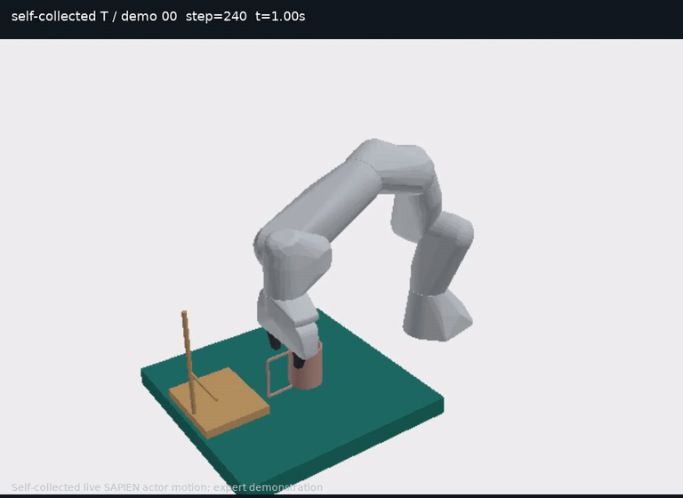 |  |

### Low-quality trajectory review of all training demonstrations

The following ten GIFs are low-quality playback exports of every complete
expert demonstration used by the latest SAPIEN training run (`demo_00`–
`demo_09`). They are provided for trajectory inspection; they are not new
simulator screenshots. The source run is
`self_collected_mug_pick_place_v20_frozen_10_20261107`, with ten successful
episodes and live SAPIEN actor-mesh observations.

[Open the three-frame contact sheet](assets/riemann/sapien/expert_demos_low_quality_contact_sheet.png) ·
[Open the trajectory audit chart](assets/riemann/sapien/expert_demos_low_quality_trajectory_diagnostics.png) ·
[Open the machine-readable audit](assets/riemann/sapien/expert_demos_low_quality/audit.json)

| Expert demonstration 00 | Expert demonstration 01 |
|---|---|
|  | 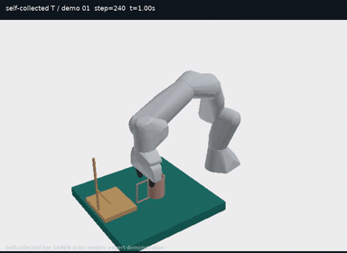 |

| Expert demonstration 02 | Expert demonstration 03 |
|---|---|
|  | 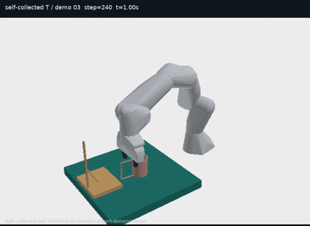 |

| Expert demonstration 04 | Expert demonstration 05 |
|---|---|
|  |  |

| Expert demonstration 06 | Expert demonstration 07 |
|---|---|
|  |  |

| Expert demonstration 08 | Expert demonstration 09 |
|---|---|
|  |  |

The trajectory record confirms a planning issue that is easy to miss at the
original playback rate. Demonstrations 00, 01, 04, 05, and 08 spend about
72–74 simulated seconds in the place stage and have a place path length
3.7–4.4 times their net displacement, which indicates repeated reversals or
replanning. Demonstration 08 also contains a single-frame 0.188 rad joint
step and a 22.1 rad/s recorded joint-speed peak; demonstration 05 reaches
12.7 rad/s. These are retained as recorded expert trajectories and should be
replanned before being treated as clean supervision.

### Why the current SAPIEN demonstrations use a narrow mug distribution

The ten accepted SAPIEN episodes are a calibrated **T-condition collection**.
The mug pose changes slightly with the scene seed, but scale, distractors, and
the target rack remain fixed. The purpose was to first check observation/action
alignment and obtain a stable expert target in the reconstructed environment.
Changing only the robot path while keeping exactly the same observation would
create ambiguous supervision for a deterministic policy: the policy would have
no input telling it which equally valid path to choose. For a generalization
dataset, the correct next step is to change the mug SE(3) pose deliberately,
then geometry and distractors, capture a fresh live point cloud, and record the
complete action sequence for every reset. Keep that collection separate from
the calibrated T set.

The editable collection template is
[`examples/sapien_custom_demonstration.py`](examples/sapien_custom_demonstration.py).
The complete adapter, planning, audit, and sequence-training workflow is in
[`docs/sapien_custom_demonstration_workflow.md`](docs/sapien_custom_demonstration_workflow.md).
It exposes mug position, roll/pitch/yaw, scale, distractor count, seed, and
named approach/grasp/lift/transport/insert/retreat waypoints. Bind its small
`SapienAdapter` interface to the local SAPIEN actor builder, camera renderer,
and collision-aware planner, then run for example:

```bash
python examples/sapien_custom_demonstration.py --print-plan \
  --mug-x 0.42 --mug-y -0.08 --mug-yaw-deg 15 --seed 12
python examples/sapien_custom_demonstration.py \
  --adapter my_sapien_adapter:create_adapter \
  --mug-x 0.42 --mug-y -0.08 --mug-yaw-deg 15 --seed 12 \
  --output runs/custom_sapien_demo_12
```

The adapter must return one live XYZ/RGB observation per control step. The
template writes `scene_spec.json`, `trajectory.json`, compressed aligned
`observations.npz`, hashes, and an optional playable `rollout.gif`; failed
episodes should be retained and audited before training.

## 2. RLBench environment and final results

### Evaluation environment

The final model comparison uses RLBench `PickUpCup` with live multi-camera
observations, the same planner/controller interface, native task success
predicate, paired initial states, and the frozen v5 evaluation manifest. The
20 episodes contain 8 training-scene replays, 2 validation-scene replays, and
10 fresh episodes. This is an independent RLBench diagnostic line and is not
combined with SAPIEN numbers or used as a paper-level generalization claim.

### Model structure, parameter count, and action error

The action error is the complete live chain `phi -> predicted ROI -> psi`,
measured against the expert target on the paired RLBench episodes. Position is
reported in millimetres and rotation as an SO(3) geodesic angle.

| Model | Compact structure | Parameters (phi / psi / total) | Live action error (mm / deg) |
|---|---|---:|---:|
| B0 | 4 + 4 SE(3) kernel-attention layers | 296,460 / 439,880 / **736,340** | 64.82 / 42.57 |
| M2 | 3 + 3 layers; `{0:4, 1:4, 2:2}` | 4,316 / 8,639 / **12,955** | 111.82 / 126.40 |
| M2wide | 3 + 3 layers; `{0:16, 1:16, 2:8}` | 28,466 / 56,963 / **85,429** | 75.49 / 83.60 |
| M2isomorphicB0 | 4 + 4 layers; `{0:8, 1:8, 2:8, 3:8}` | 20,477 / 40,969 / **61,446** | 125.84 / 72.08 |
| M2wideisomorphicB0 | 4 + 4 layers; `{0:16, 1:16, 2:16, 3:16}` | 64,109 / 128,249 / **192,358** | 84.56 / 72.79 |

### Final paired success results

| Model | Train replay | Validation replay | Fresh episodes | Total success |
|---|---:|---:|---:|---:|
| B0 | 5/8 | 0/2 | 3/10 | **8/20 (40%)** |
| M2 | 3/8 | 0/2 | 0/10 | **3/20 (15%)** |
| M2wide | 3/8 | 0/2 | 1/10 | **4/20 (20%)** |
| M2isomorphicB0 | 5/8 | 0/2 | 1/10 | **6/20 (30%)** |
| M2wideisomorphicB0 | 5/8 | 0/2 | 0/10 | **5/20 (25%)** |

The reported counts are native RLBench task outcomes. They are kept separate
from expert-demo success and from the reconstructed SAPIEN environment.

### All ten RLBench training demonstrations

These are the ten complete expert trajectories used to build the frozen
target-pose training set. The GIFs are low-quality 128x128 playback exports
from the native RLBench expert execution; they are separate from the learned
rollout examples below.

[Open the RLBench expert contact sheet](assets/rlbench/expert_demos_low_quality_contact_sheet.png) ·
[Open the expert trajectory audit](assets/rlbench/expert_demos_low_quality/audit.json) ·
[Read the complete trajectory and training workflow](docs/rlbench_demonstration_workflow.md)

| Expert demonstration 00 | Expert demonstration 01 |
|---|---|
| 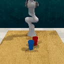 | 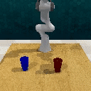 |

| Expert demonstration 02 | Expert demonstration 03 |
|---|---|
|  | 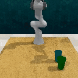 |

| Expert demonstration 04 | Expert demonstration 05 |
|---|---|
| 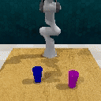 | 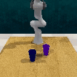 |

| Expert demonstration 06 | Expert demonstration 07 |
|---|---|
| 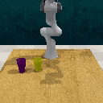 | 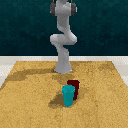 |

| Expert demonstration 08 | Expert demonstration 09 |
|---|---|
| 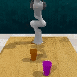 | 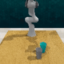 |

The current target-pose adapter retains the complete source trajectories but
samples 20 pre-close frames per episode for training. It predicts a future
Panda-tip target pose from each XYZRGB observation; it is not a full action
sequence policy. The workflow document describes how to store complete
trajectories and how to convert them into either this adapter's format or a
true horizon-based trajectory dataset.

### Four RLBench rollout examples

The four GIFs below are playable exports of saved RLBench rollout videos: two
successful episodes and two failed episodes from the same paired evaluation.
They are exported at 512x512 for clear repository playback.

| Successful rollout: M2isomorphicB0, episode 000 | Successful rollout: M2wideisomorphicB0, episode 000 |
|---|---|
|  | 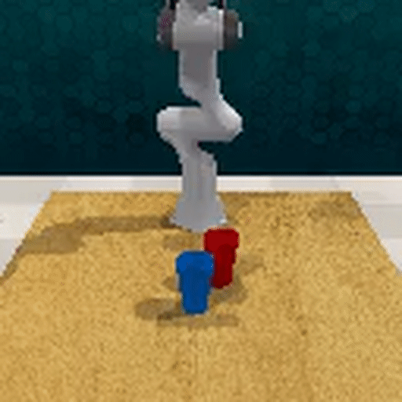 |

| Failed rollout: M2isomorphicB0, episode 002 | Failed rollout: M2wideisomorphicB0, episode 001 |
|---|---|
| 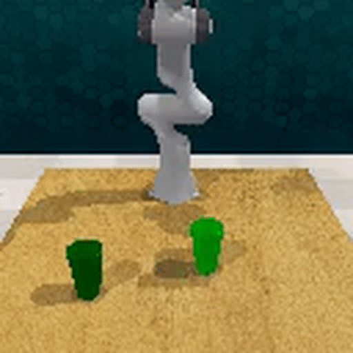 | 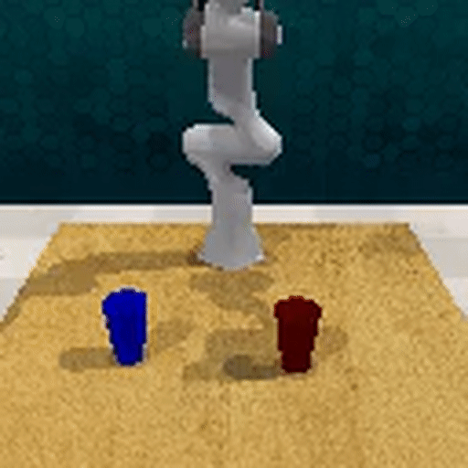 |

Machine-readable summaries are available in
[`results/riemann/latest_isomorphic_rlbench_summary.json`](results/riemann/latest_isomorphic_rlbench_summary.json).

## 3. Isaac Lab x ET-SEED plan

The image below is the English environment summary figure from the ET-SEED
paper/project page. It is a reference for the planned Isaac Lab integration,
not a result produced by this repository.


### Plain-text replacement boundary

```text
[UNCHANGED] Isaac Lab scene reset, PhysX/RTX sensors, camera calibration,
            contact simulation, parallel rollout, and task success predicate.

[REPLACED] ET-SEED visual condition encoder
            -> RiEMann phi (saliency / object geometry)
            -> ROI adapter
            -> RiEMann psi (translation + type-1 orientation)
            -> SE(3) condition tokens.

[UNCHANGED] ET-SEED trajectory-level SE(3) diffusion denoiser,
            action horizon, denoising loss, and rollout interface.
```

The first experiment will hold demonstrations, action horizon, optimizer,
controller, and random seeds fixed while comparing B0, M2, M2wide, and the
two B0-isomorphic variants. Isaac Lab x ET-SEED remains planned; no success
rate is reported here.

## References and scope

- RiEMann: <https://github.com/HeegerGao/RiEMann> ·
  <https://arxiv.org/abs/2403.19460>
- RLBench: <https://github.com/stepjam/RLBench>
- ET-SEED: <https://github.com/yuechen0614/ET-SEED> ·
  <https://et-seed.github.io/>
- Isaac Lab: <https://isaac-sim.github.io/IsaacLab/>

The reconstructed SAPIEN environment and the RLBench diagnostic are reported
as separate experiments. Private checkpoints, raw demonstrations, and
absolute local paths are not redistributed in this repository.
