# SO(3)-Equivariant Transformer for Robot Manipulation Policy

An auditable experimental record of point-cloud equivariant Transformer policies
for robot manipulation, covering strict reproduction, architectural ablations,
out-of-distribution generalization, pose accuracy, equivariance, efficiency, and
reconstructed simulation.

> **Repository scope.** This repository is a public experiment portfolio, not a
> training-code release. All reported values come from completed experiments and
> frozen artifacts. The figures are reused directly from the corresponding
> simulation runs; no result figure was regenerated for this homepage. Checkpoints,
> raw data, private run paths, and the `e2tsp-escnn` implementation are excluded.

## Research Experience

- **EquiBot / SO(3)-equivariant encoder ablation.** Strictly reproduced EquiBot
  and vanilla Diffusion Policy, then designed and trained E2-Linear-K8 by replacing
  VN-PointNet with a 4-layer ESCNN SO(3) local-attention encoder while holding the
  EquiBot canonicalization, vector diffusion head, training data, and budget fixed.
  Completed 2,000 epochs / 120,000 optimizer steps, actor/EMA strict-load audits,
  and 40 exactly scene-paired OOD rollouts. E2 preserved Original reward
  (`0.987269` vs. DP `0.987363`) and increased mean reward across the three OOD
  settings from `0.040051` to `0.925496`; the four-setting macro paired delta was
  `+0.664060`, with a 95% bootstrap CI of `[+0.516306, +0.808862]`.
- **RiEMann / SE(3)-equivariant policy reproduction and efficiency study.**
  Completed 18 formal two-stage Phi/Manipulation training stages for B0, M1, and
  M2 across three training seeds, audited 36 checkpoints, and ran 360 held-out pose
  predictions, 486 equivariance cases, 3,600 CUDA-synchronized timing samples, and
  900 paired SAPIEN proxy episodes. M2 reduced parameters by `98.24%` and achieved
  `5.556x` model-only and `3.628x` end-to-end speedups, but its rotation error rose
  to `60.346 deg`. M1 reached `67.0%` overall success on the reconstructed proxy
  benchmark, `12.7 pp` above B0, identifying the type-1 / rotation branch as the
  primary quality bottleneck in the lightweight design.
- **WAM and real-robot roadmap (planned).** Plan to apply equivariant Transformers
  to the emerging World-Action Model (WAM) paradigm, first testing the stability,
  latency, and OOD generalization of interactions between geometric equivariant
  representations and world/action tokens in simulation, then attempting
  real-robot inference on i2RT. This is a research plan with no reported results;
  it is kept separate from the two completed studies. See
  [OpenWAM](https://openwam.stanford.edu/) for background.

## Project Overview

The two completed experiment tracks address complementary questions:

| Track | Research question | Task and evidence | Current conclusion |
|---|---|---|---|
| EquiBot E2 | Can a fully equivariant system improve robustness to scale, rotation, and position shifts? | Object Covering; 40 DP episodes and 40 E2 episodes with 40/40 exact scene pairs | Strong OOD advantage in the seed-0 pilot; not yet a formal multi-seed result |
| RiEMann B0/M1/M2 | Can geometric-kernel reuse reduce latency and memory while preserving quality? | 3 seeds; 360 pose predictions, 486 equivariance cases, 3,600 timing samples, and 900 proxy episodes | M2 is fastest and smallest but loses orientation quality; M1 has the highest proxy success rate |
| WAM roadmap | Can equivariant geometric priors be integrated into joint world/action prediction? | Planned: simulation -> i2RT real robot | Not executed; no result is claimed |

The group actions form distinct levels: SO(3) describes rotation, SE(3) also
includes translation, and SIM(3) additionally includes scale. This project studies
how SO(3)-equivariant Transformer modules can be embedded in SE(3)/SIM(3) robot
policies; it does not treat the three groups as the same experimental setting.

## 1. EquiBot: E2-Linear-K8

### 1.1 Simulation Tasks

The following animations show actual rollouts from the frozen local EquiBot E0
baseline: Cloth Folding, Object Covering, and Box Closing. Each GIF is a direct
format conversion of the corresponding `Original / seed 0 / ckpt01999 / episode 00`
evaluation video. The E2 training and strict paired comparison in this study use
**Object Covering only**.

| Cloth Folding (reward 1.000000) | Object Covering (reward 0.981746) | Box Closing (reward 0.999697) |
|---|---|---|
| 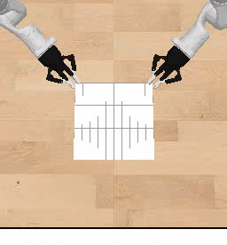 | 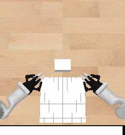 | 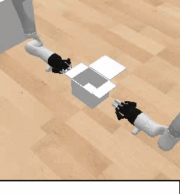 |

The experiments use the public environments, data-generation process, and
evaluation interfaces from [EquiBot](https://github.com/yjy0625/equibot). The
cover dataset contains 50 demonstrations and 1,948 time steps. Each raw point
cloud has 4,096 points, with 1,024 points sampled and shuffled during training.
All comparisons use the same frozen data with `num_augment=0`.

### 1.2 Architecture and Controlled Variables

E2 is an **encoder-only ablation** relative to the official EquiBot E0 model:

| Component | Official E0 | E2-Linear-K8 | Changed? |
|---|---|---|---|
| Point-cloud encoder | 4-layer VN-PointNet | 4-layer ESCNN SO(3) local-attention encoder | Yes |
| Graph structure | kNN, K=8 | kNN, K=8 | No |
| Equivariant Q/K/V | Internal VN structure | Linear Q/K/V | Primary variable |
| Embedding irreps | VN vector features | `l=1:64`, `l=2:64` | Primary variable |
| Q/K irreps | Not applicable | `l=1:32`, `l=2:32` | Primary variable |
| Attention | Local kNN | 8 heads, within-irrep dot product + distance bias | Primary variable |
| Policy canonicalization | SIM(3) center/scale | Same | No |
| Diffusion head | Vector Conditional U-Net | Same | No |
| Actor/EMA/checkpoint API | Official EquiBotAgent | Same, default strict load | No |

E2 preserves the official `center / scale / so3 / inv` shape, dtype, and device
contract. Neither training nor evaluation uses `strict=False`. E0 has
`124,637,522` trainable parameters and E2 has `124,625,778`, a difference of only
`-0.0094%`.

The vanilla DP baseline is a system-level control. It uses a scalar
PointNetEncoder and scalar Conditional U-Net without EquiBot's SIM(3) policy
canonicalization. Therefore, **DP vs. E2 evaluates the complete equivariant
system, but cannot attribute the gain to the encoder alone**.

### 1.3 Frozen Training Protocol

| Parameter | Vanilla DP | Official E0 | E2 |
|---|---:|---:|---:|
| Task / training seed | cover / 0 | cover / 0 | cover / 0 |
| Epochs / optimizer steps | 2,000 / 120,000 | 2,000 / 120,000 | 2,000 / 120,000 |
| Batch size / workers | 32 / 12 | 32 / 12 | 32 / 12 |
| Learning rate / weight decay | `3e-5` / `1e-6` | Same | Same |
| Point count / hidden dimension | 1,024 / 128 | Same | Same |
| Encoder layers | 4 | 4 | 4 |
| Observation / prediction / action horizon | 2 / 16 / 8 | Same | Same |
| DDPM | 100 steps, epsilon prediction | Same | Same |
| Inline evaluation / compile | Disabled / disabled | Same | Same |

All runs used an NVIDIA L20Z. Full 2,000-epoch training took `1:08:28` for DP,
`9:03:35` for E0, and `39:26:01` for E2. E2 was `4.35x` slower than E0 and
`34.56x` slower than DP, with peak memory of `19,151 MiB`. The cost comes mainly
from irreps, basis expansion, and equivariant linear/attention operators, not from
global point-cloud attention: E2 uses a K=8 local kNN graph.

### 1.4 Strict Paired Evaluation

Evaluation was frozen to cover / training seed 0 / `ckpt01999`, with 10 episodes
for each of four setups:

- Original: no override of the original position, scale, or rotation.
- R+Su: z-axis rotation + `[1,2]` uniform scale.
- R+Sn: z-axis rotation + `[1,2]` nonuniform scale, with maximum aspect ratio 1.33.
- R+Sn+P: R+Sn + xy Gaussian position offset, with `rand_pos_scale=0.5`.

Across the 40 paired DP/E2 episodes, the frozen artifacts matched exactly for
initial state (40/40), randomization (40/40), and initial point cloud (40/40,
element-wise). Training and inference seeds were both 0; environment seeds were
0 through 9. The audit reloaded all 80 NPZ files and validated all 80 MP4 files
with ffprobe. Paired bootstrap used seed `20261027` and 100,000 resamples.

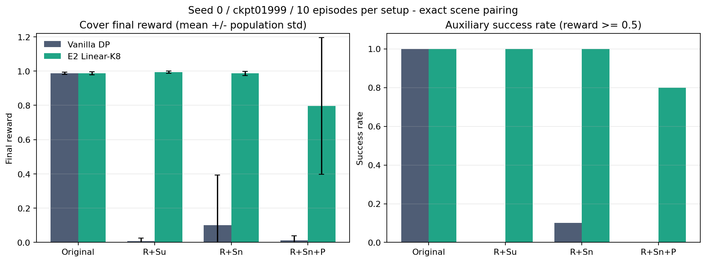

| Setup | DP reward mean +/- population std | DP success | E2 reward mean +/- population std | E2 success | E2-DP | Paired 95% CI |
|---|---:|---:|---:|---:|---:|---:|
| Original | 0.987363 +/- 0.007382 | 100% | 0.987269 +/- 0.007926 | 100% | -0.000094 | [-0.005829, +0.005487] |
| R+Su | 0.007420 +/- 0.018566 | 0% | 0.993273 +/- 0.006477 | 100% | +0.985852 | [+0.973587, +0.994892] |
| R+Sn | 0.099644 +/- 0.294074 | 10% | 0.986715 +/- 0.012242 | 100% | +0.887071 | [+0.687928, +0.991957] |
| R+Sn+P | 0.013087 +/- 0.026285 | 0% | 0.796499 +/- 0.398265 | 80% | +0.783412 | [+0.492443, +0.986028] |
| **Four-setup macro** | **0.276879** | - | **0.940939** | - | **+0.664060** | **[+0.516306, +0.808862]** |

The equal-weight mean over the three OOD settings was `0.040051` for DP and
`0.925496` for E2, an improvement of `+0.885445`. The Original-to-R+Sn+P gap
decreased from `0.974276` for DP to `0.190770` for E2. The Original confidence
interval crosses zero, so the sample shows no detectable in-distribution loss for
E2; the paired deltas for all three OOD setups are positive.

### 1.5 Failure Cases

Under R+Sn+P, E2 failed at environment seeds 2 and 6 and succeeded at seed 9:

| Seed 2: failure | Seed 6: failure | Seed 9: successful reference |
|---|---|---|
| 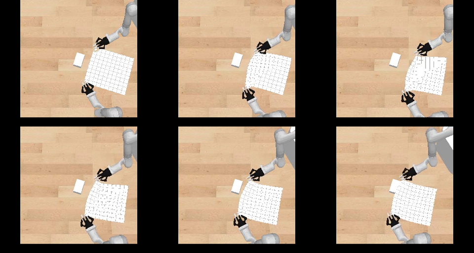 | 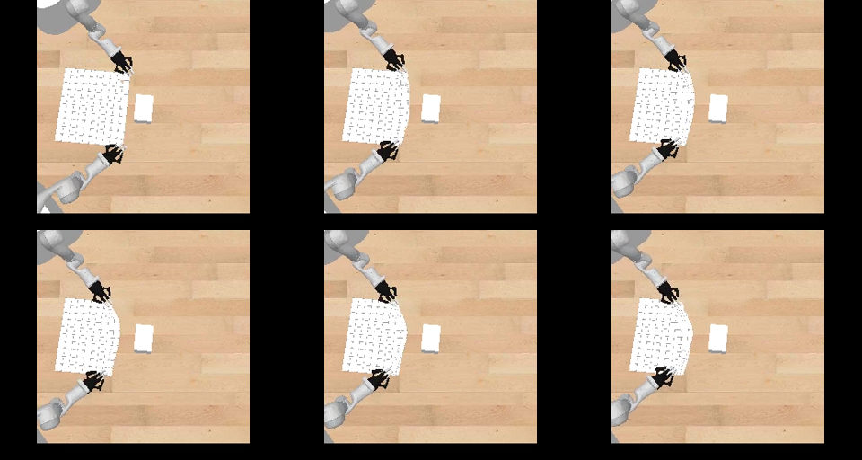 | 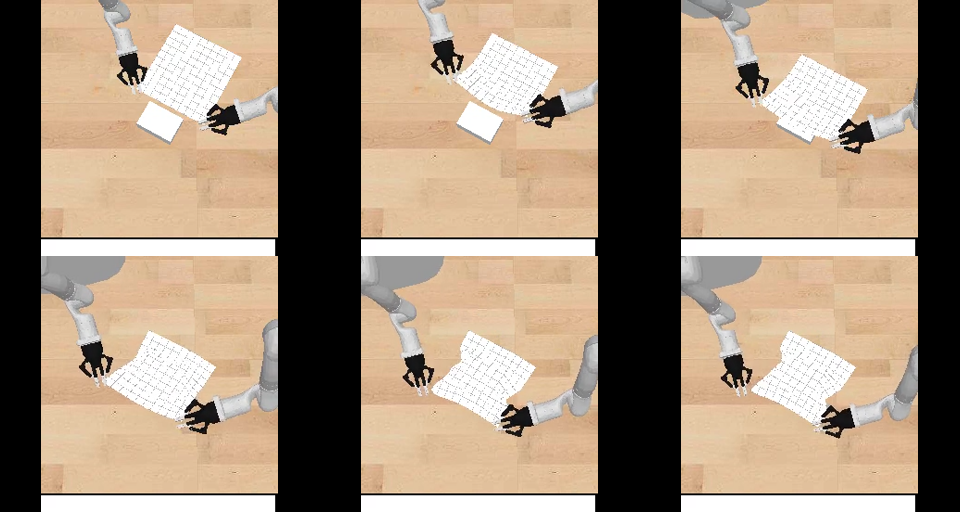 |

Seeds 2 and 6 had the largest position offsets in this E2 batch, with offset
norms of `1.123765` and `1.349614`. The other eight scenes had offset norms no
greater than `0.837757` and all succeeded. In the strict DP pairs, seeds 2 and 6
also failed, while all other eight R+Sn+P scenes remained below the success
threshold. The system difference therefore cannot be explained by mismatched
scene difficulty.

### 1.6 Supported and Unsupported Conclusions

**Supported:** Within this seed-0, single-checkpoint pilot of 40 exactly paired
scenes, the complete E2 equivariant system preserves Original performance and
substantially improves reward under rotation, scale, and position OOD shifts.

**Not supported:** This is not a formal study over three training seeds and the
last five checkpoints. It also cannot isolate the contributions of the ESCNN
encoder, SIM(3) canonicalization, and vector diffusion head. The E0/E2 encoder-only
pilot used different environment reset order and is descriptive only. A valid next
causal experiment should freeze the E2 encoder, data, canonicalization, action
representation, and budget; change only the diffusion head; and explicitly record
the vector-to-scalar adapter.

## 2. RiEMann: B0 / M1 / M2

### 2.1 Reproduction and Ablation Goal

This study builds on the public [RiEMann](https://github.com/HeegerGao/RiEMann)
implementation and examines the accuracy, equivariance, and efficiency trade-offs
of SE(3)-equivariant policies. The shared prediction chain is: Phi saliency center
-> ROI 1 -> psi1 translation -> psi2 type-1 vectors -> ROI 2 pooling -> modified
Gram-Schmidt rotation.

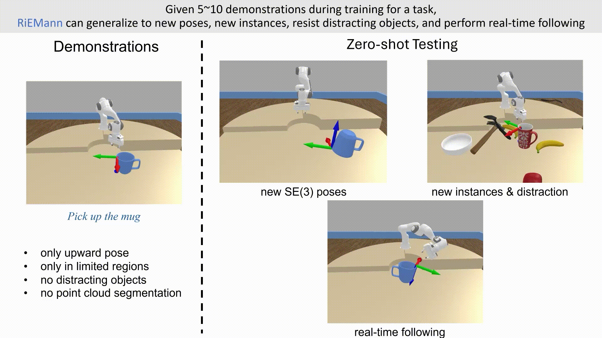

> The image above reuses `web_teaser.gif` from RiEMann's official MIT-licensed
> repository only to illustrate the original task format. Quantitative results in
> this repository come from the local reproduction and reconstructed proxy benchmark.

### 2.2 Models

| Model | Backbone definition | Parameters | Reduction vs. B0 |
|---|---|---:|---:|
| B0 | Official RiEMann SE(3)-Transformer | 736,340 | 0% |
| M1 | Per-layer relative-edge equivariant Transformer | 93,706 | 87.27% |
| M2 | One relative-edge geometry lift, then equivariant linear Q/K/V + local invariant attention | 12,955 | 98.24% |

M2 tests the computational hypothesis that expensive steerable edge kernels can
be restricted to the first geometry-lifting step, while later layers reuse the
lifted equivariant features. The results confirm lower latency and memory, but the
type-1 / rotation branch does not retain B0's orientation quality.

### 2.3 Frozen Training Protocol

| Parameter | Setting |
|---|---|
| Models / seeds | B0, M1, M2; training seeds 0, 1, 2 |
| Two-stage training | Phi first, then Manipulation (`psi1/psi2`) for each seed |
| Input points / batch | 2,500 / 1 |
| Data split | Trajectory-level 8 train / 2 validation, preventing adjacent-frame leakage |
| Phi | 200 epochs, Adam LR `1e-3` |
| Manipulation | 500 epochs, Adam LR `5e-4` |
| Scheduler | StepLR; Phi 40 epochs x 0.5, Mani 166 epochs x 0.5 |
| Precision | FP32, no BF16/AMP |
| Checkpoint | Per-model/per-seed best; Phi passes only to Mani with the same seed |
| ROI | GT center for Mani train/validation; same-seed Phi predicted center for formal inference |

All 18 formal stages reached Phi epoch 199 or Mani epoch 499. Mean seconds per
epoch across three seeds were: B0 Phi/Mani `92.817/49.076`, M1 `134.449/81.818`,
and M2 `31.066/46.830`.

### 2.4 Offline Evaluation Protocol

- **Pose accuracy:** two held-out trajectories per model/seed, 40 frames total;
  the complete predicted Phi -> Psi chain, with no GT-center substitution.
- **Equivariance:** global rotation, global translation, and point permutation on
  18 inputs per model/seed, for 486 cases.
- **Efficiency:** one L20Z, batch 1, 2,500 points; 10 warm-up iterations followed
  by 200 CUDA-synchronized timing iterations; 1,800 model-only and 1,800
  end-to-end measurements.
- **Significance:** paired by seed and repeat; 600 pooled pairs and 10,000
  bootstrap resamples.
- **Statistical unit:** cross-model conclusions use the three independent training
  seeds, not adjacent video frames as independent training replicates.

| Model | Translation error cm | Rotation error deg | Model-only p50 ms | End-to-end p50 ms | Peak memory MiB |
|---|---:|---:|---:|---:|---:|
| B0 | **0.7237** | **6.514** | 230.977 | 240.816 | 18,125.1 |
| M1 | 0.7979 | 12.220 | 305.014 | 324.981 | 2,168.7 |
| M2 | 1.5482 | 60.346 | **40.841** | **66.201** | **441.1** |

| Accuracy | Equivariance and efficiency |
|---|---|
| 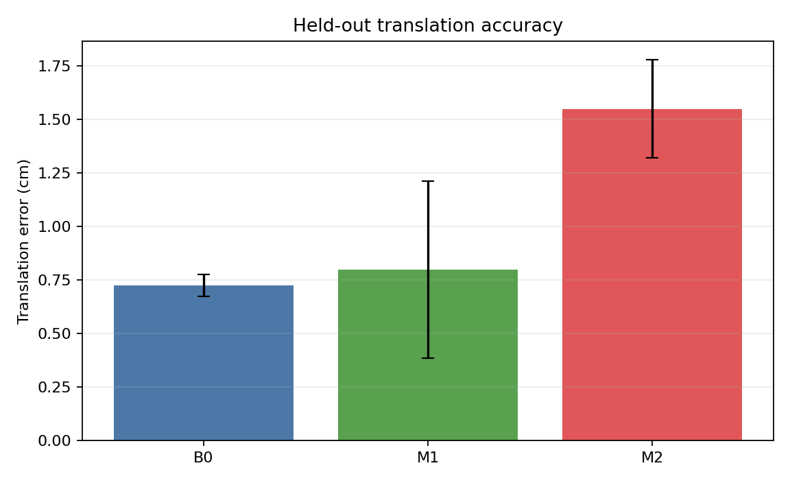 | 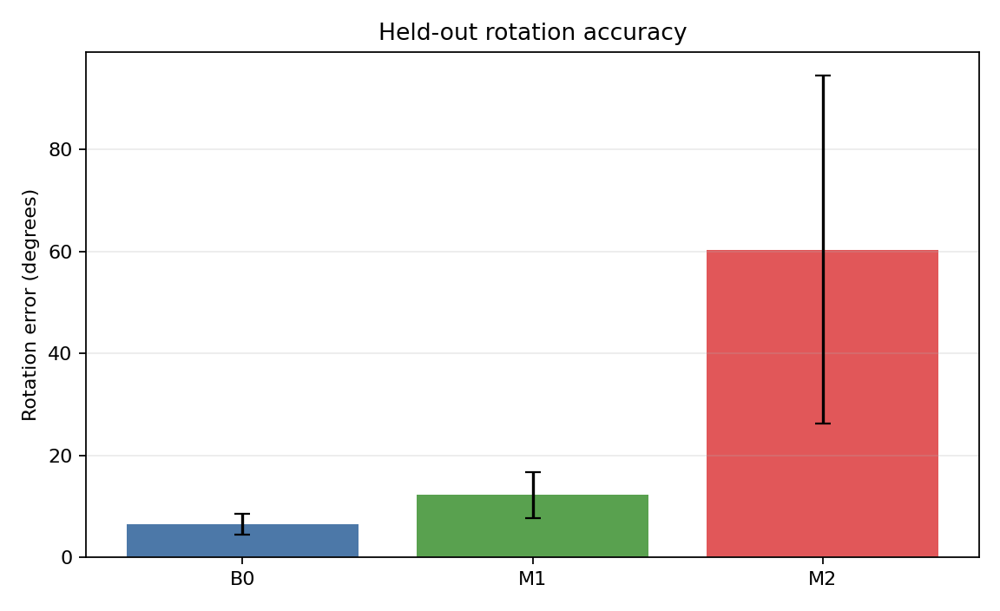 |
| 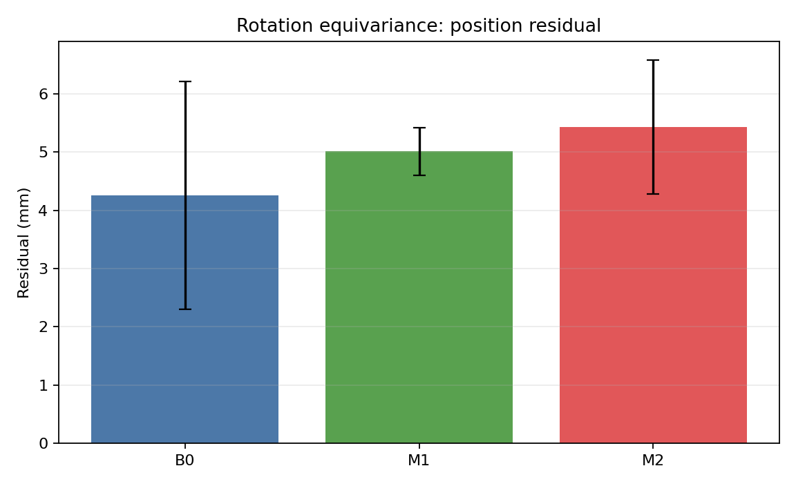 | 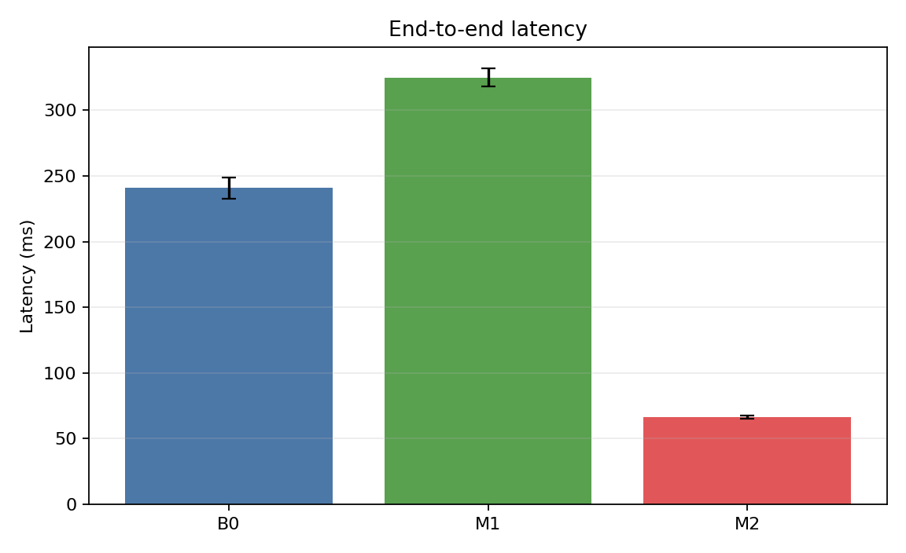 |

Relative to B0, M2 achieved a `5.556x` model-only speedup with a 95% paired
bootstrap CI of `[5.531x, 5.579x]`, and a `3.628x` end-to-end speedup with a CI
of `[3.590x, 3.665x]`. M1 reached only `0.755x / 0.741x` of B0's model-only /
end-to-end speed, showing that fewer parameters do not automatically yield faster
equivariant execution.

For rotated inputs, B0/M1/M2 rotation residuals were
`2.346 / 6.332 / 22.408 deg`. M2 instead had the lowest center residual
(`4.467 mm`). The degradation is therefore concentrated in the orientation/type-1
outputs and their composition, not simply in center localization.

### 2.5 Reconstructed SAPIEN Proxy Benchmark

The paper's private scene, camera calibration, full mug place stage, and success
criteria were not released. This evaluation is therefore strictly labeled a
**reconstructed proxy benchmark**, not a reproduction of the paper's Mug-on-Rack
success rate. Policy observations use RiEMann's official fused point clouds for
T/NI/NP/DO/ALL plus deterministic target-only transforms. Predicted poses are
executed through a shared SAPIEN 2.2.2 / MPlib 0.1.1 pipeline.

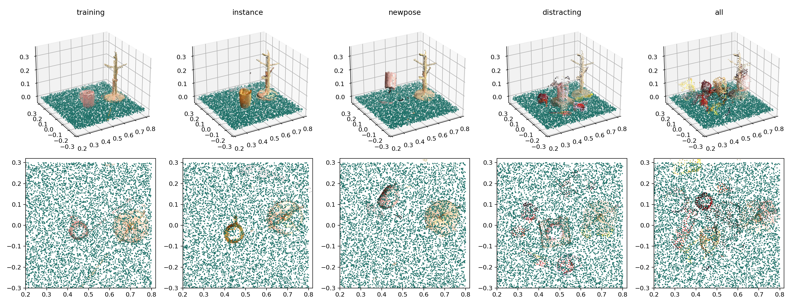

The benchmark contains 3 models x 3 training seeds x 5 conditions x 20 paired
scene seeds = 900 episodes. Franka Panda executes pregrasp -> grasp -> close ->
lift. After bilateral finger contact, the target must remain at `z >= 0.15 m` for
120 consecutive physics steps to count as a success.

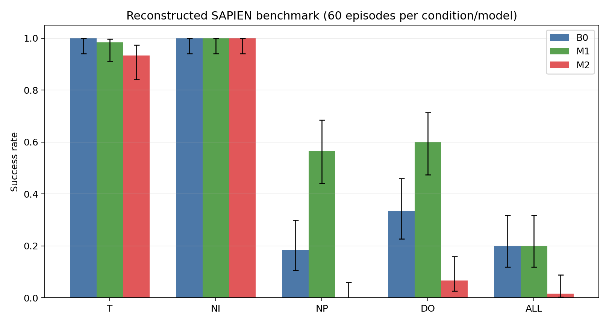

| Condition | B0 | M1 | M2 |
|---|---:|---:|---:|
| T | 60/60 (100.0%) | 59/60 (98.3%) | 56/60 (93.3%) |
| NI | 60/60 (100.0%) | 60/60 (100.0%) | 60/60 (100.0%) |
| NP | 11/60 (18.3%) | **34/60 (56.7%)** | 0/60 (0.0%) |
| DO | 20/60 (33.3%) | **36/60 (60.0%)** | 4/60 (6.7%) |
| ALL | 12/60 (20.0%) | 12/60 (20.0%) | 1/60 (1.7%) |
| **Overall** | **163/300 (54.3%)** | **201/300 (67.0%)** | **121/300 (40.3%)** |

M1 exceeded B0 overall by `+12.7 pp` (paired exact McNemar `p=5.85e-6`), driven
primarily by NP and DO. M2 was `-14.0 pp` below B0 (`p=1.31e-10`). None of the
900 episodes had a runtime error.

### 2.6 Interpretation Boundaries

1. The proxy is not the paper's private Mug-on-Rack benchmark and does not include
   the full place stage.
2. Observations come from official static fused point clouds and deterministic
   target transforms, not frame-by-frame closed-loop RGB-D.
3. The mug uses proxy collision bodies and a rigid latch after bilateral contact.
   This is valid for comparisons under the same protocol, but it is not a
   substitute for high-fidelity contact simulation or a real robot.
4. The 20 scene seeds per condition are derived from one official condition point
   cloud, not 20 independent assets or camera domains.
5. The 600 paired timing repeats measure stability on fixed hardware and input;
   they are not 600 independent training experiments.

The appropriate model therefore depends on the objective: B0 has the best offline
pose accuracy, M1 has the highest reconstructed proxy success rate, and M2 has the
fewest parameters and lowest memory and latency, but its current orientation quality
does not support unconditional replacement of B0 or M1.

## 3. Strict Reproduction and Validation Workflow

Both experiment tracks use the same engineering principles:

1. **Freeze evidence sources:** record papers, official READMEs, source commits,
   data, and protocol SHA-256 values.
2. **Separate experiment paths:** label paper-specified settings, officially
   executable configurations, and custom ablations; never mix them silently.
3. **Run environment and GPU preflight:** freeze Python/PyTorch/CUDA/extension
   versions and execute real forward/backward, finite loss/gradient, peak-memory,
   and checkpoint round-trip tests.
4. **Run a minimal smoke test:** validate launchers, logging, save/load/resume, and
   evaluation interfaces before formal training. Stop at a failed gate rather than
   bypassing it by changing the model or using `strict=False`.
5. **Run formal training:** freeze seeds, data splits, training budgets, checkpoint
   selection, and resource logs. Multi-GPU execution parallelizes independent runs
   without changing the optimization semantics of an individual run.
6. **Audit artifacts:** inspect exit codes, DONE markers, resolved configurations,
   checkpoint strict loading, NaN/OOM status, logs, and manifests.
7. **Pair evaluation scenes:** whenever possible, freeze initial state,
   randomization, input point cloud, environment/inference seeds, and checkpoint
   lineage across model comparisons.
8. **Recompute independently:** derive mean/std/success/CI from episode- or
   frame-level records and compare each value with the released summaries.
9. **Retain negative results:** report speed-quality trade-offs, failure modes,
   protocol gaps, and conclusions that the evidence cannot support.

## 4. Result Files

The repository retains public aggregate results and per-scene paired deltas so
that the README values can be independently checked:

```text
results/
|-- equibot/
|   |-- dp_e2_paired_deltas.csv
|   `-- dp_e2_paired_summary.json
`-- riemann/
    |-- offline_summary.csv
    |-- seed_summary.csv
    |-- equivariance.csv
    |-- efficiency.csv
    |-- speed_significance.csv
    |-- simulation_summary.csv
    |-- simulation_seed_summary.csv
    |-- simulation_paired_comparisons.csv
    `-- simulation_failure_taxonomy.csv
```

`MANIFEST.sha256` freezes the README, result files, and media assets. The repository
does not contain training data, checkpoints, episode videos/trajectories, absolute
machine paths, or authentication material.

The two frozen source reports used to assemble this page are:

| Source report | SHA-256 |
|---|---|
| `E2_VS_BASELINE_PERFORMANCE_REPORT_ZH.md` | `080f0ffe6fdf418f99b9ae51cb572c6deaf0451f921e85d10eead8a6baa17ec1` |
| `RIEMANN_FINAL_EVALUATION_SUMMARY_ZH.md` | `8daaa49250814e8b0afd19ca086939b00c10004bf457080969feecfe58f38bf3` |

## 5. WAM -> i2RT Roadmap

World-Action Models couple future world-state prediction with action generation.
The planned work follows a simulation-first, real-robot-gated process:

1. Select a public WAM backbone and freeze the non-equivariant baseline's data,
   training budget, and inference interface.
2. Introduce an SO(3)-equivariant Transformer into the action expert or 3D token
   interaction, explicitly documenting the representation adapter so that multiple
   changes are not conflated in one ablation.
3. In simulation, gate on action success, future-state consistency,
   rotation/translation equivariance residuals, compositional OOD conditions,
   model-only/end-to-end latency, and memory.
4. After the simulation gate passes, freeze observation/action conventions,
   coordinate frames, control frequency, safety boundaries, and emergency-stop
   behavior before a small real-robot inference study on i2RT.
5. Label real-robot results separately. Do not substitute simulation success for
   physical success or present planned work as a completed result.

## 6. Hardware and Software

| Experiment | GPU | Key software |
|---|---|---|
| EquiBot E2 | NVIDIA L20Z | Python 3.10.22, PyTorch 2.1.0+cu118, PyTorch3D 0.7.7, PyBullet 3.2.6, Diffusers 0.29.2, ESCNN 1.0.11 |
| RiEMann B0/M1/M2 | 4 x NVIDIA L20Z | Python 3.8.20, PyTorch 2.1.2+cu121, ESCNN 1.0.11, torch-cluster 1.6.3, SAPIEN 2.2.2, MPlib 0.1.1 |

## 7. References and Attribution

- EquiBot: [paper](https://arxiv.org/abs/2407.01479),
  [official repository](https://github.com/yjy0625/equibot).
- RiEMann: [paper](https://arxiv.org/abs/2403.19460),
  [official repository](https://github.com/HeegerGao/RiEMann),
  [project page](https://riemann-web.github.io/).
- WAM roadmap context: [OpenWAM](https://openwam.stanford.edu/).

The experimental text, aggregate results, and locally generated figures in this
repository are released under the [MIT License](LICENSE). Reused upstream assets
and methods remain the property of their original authors; see
[THIRD_PARTY_NOTICES.md](THIRD_PARTY_NOTICES.md).
