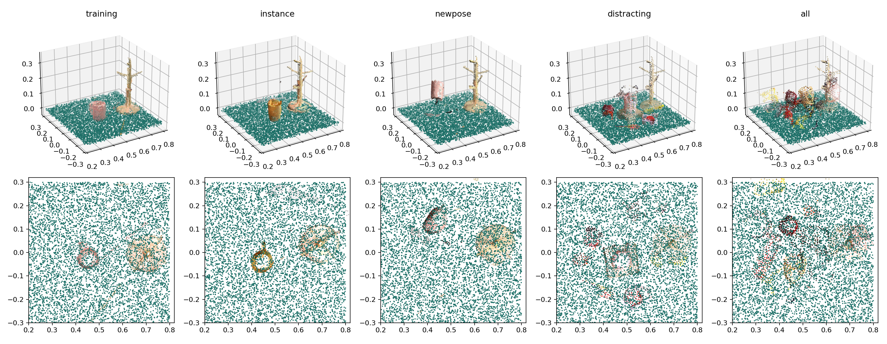
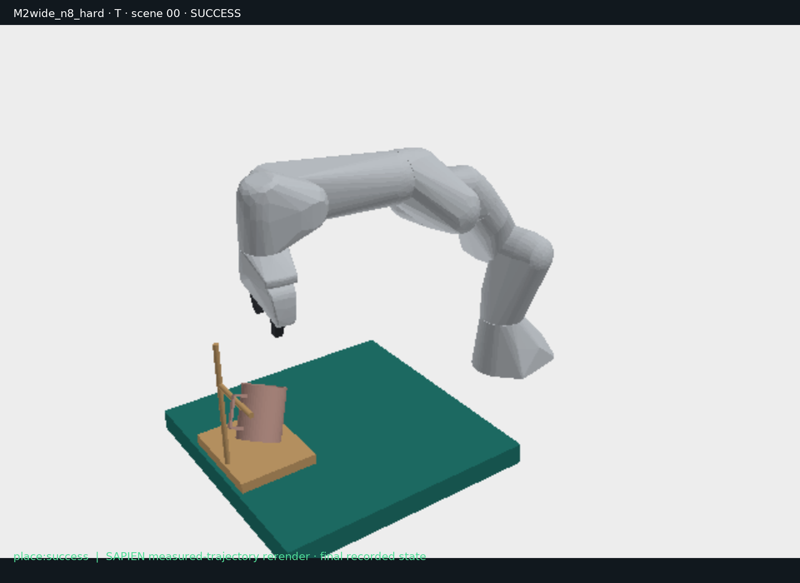
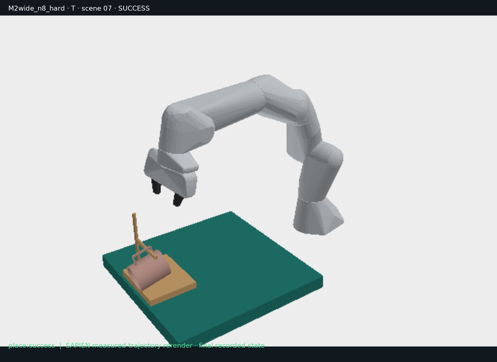
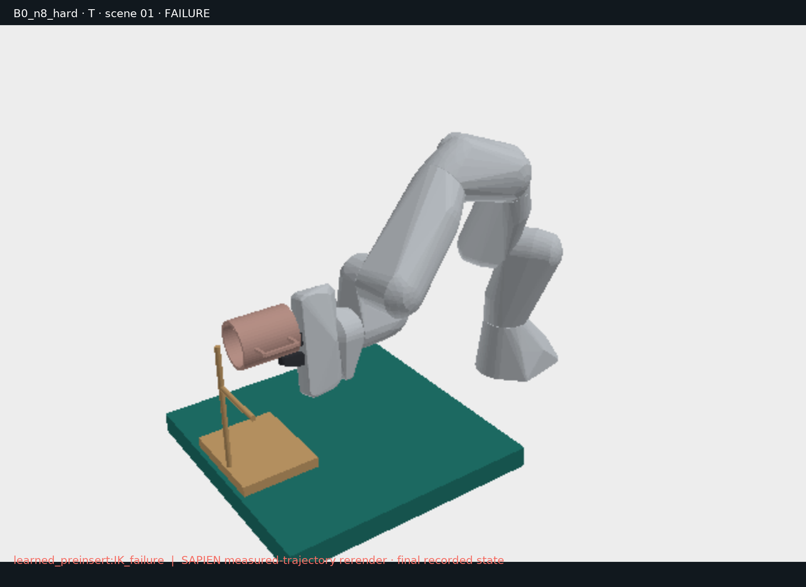
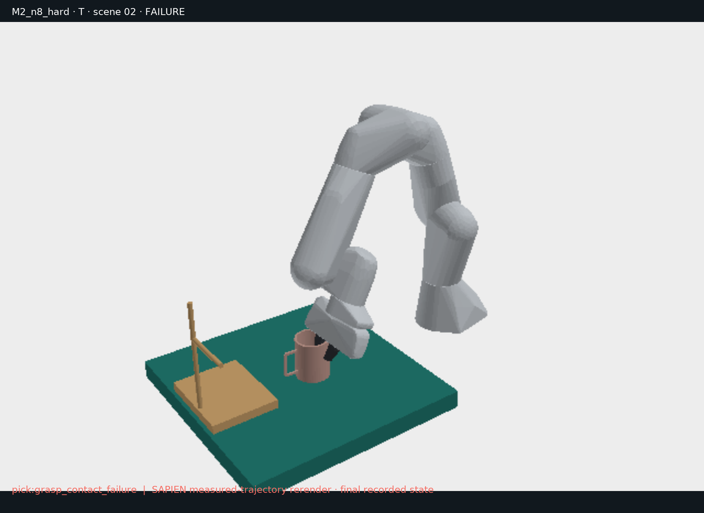
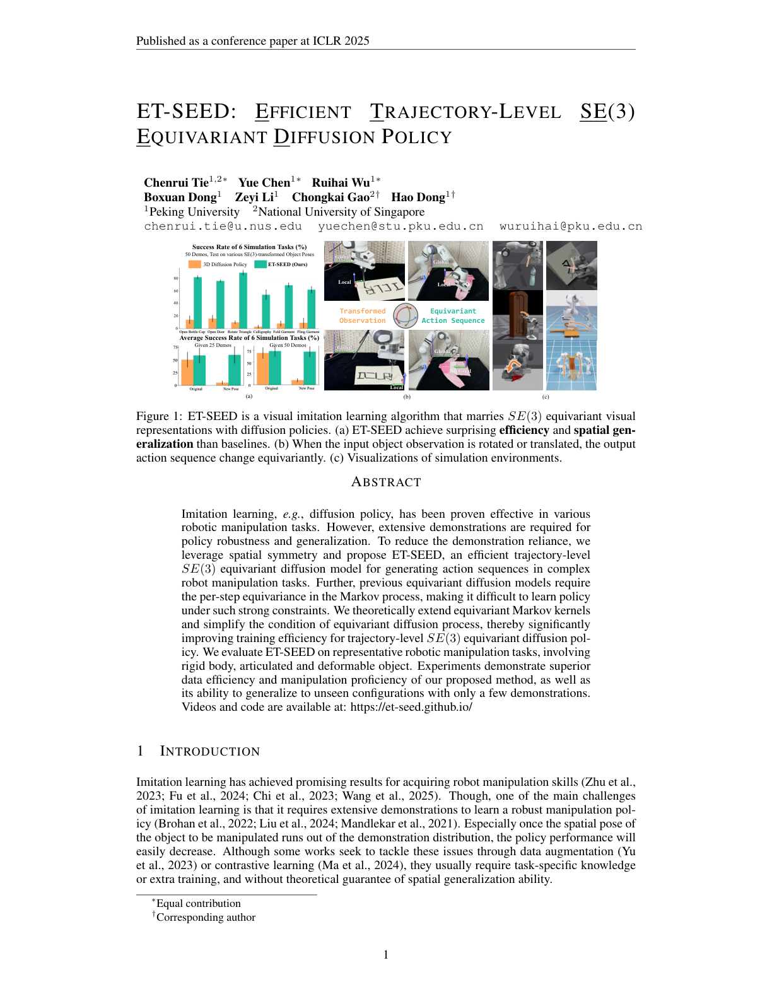
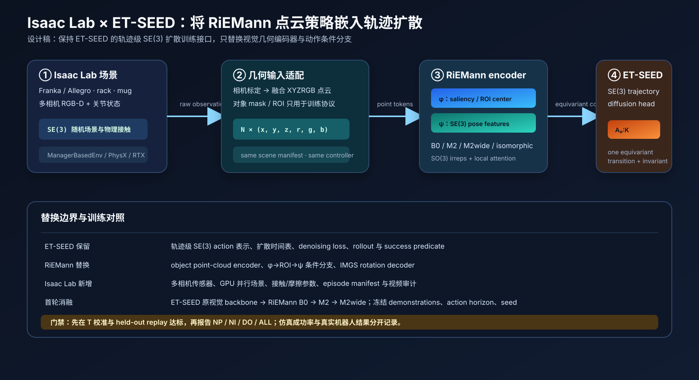

# SO(3)-Equivariant Transformer for Robot Manipulation Policy

这个仓库记录我们对点云机器人策略的可审计实验，以及下一阶段把几何等变 Transformer 接入 Isaac Lab 与 ET-SEED 的设计。页面分成两部分：第一部分是已经完成的 RiEMann / SAPIEN 线；第二部分是尚未宣称结果的 Isaac Lab × ET-SEED 计划。

> **证据边界**：论文私有 Mug-on-Rack 仿真器没有公开。本文的 SAPIEN 结果是从零搭建的、与训练分布校准的重建环境；v27 使用了已经用于开发的 20 个 T 场景，属于开发对照，不能写成论文 T 接受率或 NI/NP/DO/ALL 泛化结论。M2isomorphicB0 的最新结果来自独立的 RLBench PickUpCup 诊断，不能和 SAPIEN 数字混合。

## 第一部分：RiEMann 实验与 SAPIEN 环境

### 1. 从零搭建的 SAPIEN 场景

我们没有把静态发布点云直接喂给策略，而是重新建立了可运行的 SAPIEN 2.2.2 场景：桌面、挂架、目标杯、干扰物、Franka Panda、相机和 PhysX 接触都在当前场景中创建。网络输入来自当前场景的多相机 CPU raycast，保存为 XYZRGB；策略的 φ/ψ 输入与场景、相机和控制器逐 episode 绑定。

环境搭建的关键点如下：

- **几何与坐标**：米制世界坐标，桌面和挂架使用连续三角网格与碰撞体；目标杯的 mug-specific `r1=0.16 m`、`r2=0.02 m` 沿用严格协议选择。
- **观测**：每个抓取决策重新采集 live XYZRGB；原始协议输入为 8,192 点。目标位姿、标签和作者 anchor 不进入策略输入。
- **动作链**：`φ(saliency center) → ROI → ψ(translation + type-1 orientation) → IMGS rotation → pre-grasp / close / lift / place`。抓取成功要求双指接触并在抬升窗口保持杯子高度；完整任务还要通过挂架放置谓词。
- **可复现门禁**：冻结 scene manifest；B0、M2、M2wide 使用完全相同的抓取观测和控制器；检查 20 个独立场景规格、配对输入 hash、checkpoint hash、轨迹和失败阶段。
- **软件栈**：Python 3.8.20、PyTorch 2.1.2+cu121、CUDA runtime 12.1、DGL 2.2.1、e3nn 0.5.1、ESCNN 1.0.11、torch-scatter 2.1.2、torch-cluster 1.6.3、SAPIEN 2.2.2、MPlib 0.1.1、Open3D 0.19.0。
- **训练协议**：8 条训练 episode、seed 0、Adam `1e-4`、effective batch 4、每个模块 4,096 次更新，best checkpoint 只按训练误差选择；这是容量开发实验，不是独立测试集。

T 场景的单条件视图和组合条件视图分别保存在 [scene_T_pointcloud.png](assets/riemann/sapien/scene_T_pointcloud.png) 与 [scene_ALL_pointcloud.png](assets/riemann/sapien/scene_ALL_pointcloud.png)。这些图展示的是输入几何与条件构造，不是作者未公开的原始仿真器截图。

### 2. 模型结构、参数量与误差

所有模型都使用两阶段 φ/ψ 预测链。B0 是公开 RiEMann SE(3)-Transformer；M2 只在首层做相对边几何 lift，后续层使用等变线性 Q/K/V 与局部不变注意力；M2wide 只扩大 M2 的隐藏 fiber；M2isomorphicB0 与 M2wideisomorphicB0 把深度和最高 type 对齐到 B0，用于结构容量消融。

| 模型 | φ/ψ 层数 | hidden multiplicity | 结构重点 | φ 参数 | ψ 参数 | 总参数 |
|---|---:|---|---|---:|---:|---:|
| B0 | 4 / 4 | 官方 fiber；φ degree 0–3，ψ1 degree 0–2，ψ2 degree 0–3 | 每层 SE(3) kernel attention | 296,460 | 439,880 | 736,340 |
| M2 | 3 / 3 | `{0:4, 1:4, 2:2}` | 一次 geometry lift + 线性 Q/K/V + 局部不变注意力 | 4,316 | 8,639 | 12,955 |
| M2wide | 3 / 3 | `{0:16, 1:16, 2:8}` | M2 的宽度容量消融，深度不变 | 28,466 | 56,963 | 85,429 |
| M2isomorphicB0 | 4 / 4 | `{0:8, 1:8, 2:8, 3:8}` | M2 算子族对齐 B0 深度/type，并加同宽 output projection | 20,477 | 40,969 | 61,446 |
| M2wideisomorphicB0 | 4 / 4 | `{0:16, 1:16, 2:16, 3:16}` | 同构配置的宽度版本 | 64,109 | 128,249 | 192,358 |

M2wide 在离线 n=8 place 链上把 M2 的 predicted-ROI ψ 误差从 `12.23 mm / 59.05°` 变为 `0.78 mm / 0.71°`，同时把 place φ 从 `43.23 mm` 变为 `0.51 mm`；这是一枚单 seed 容量信号，不能当作普遍优势。M2isomorphicB0 在 RLBench 的 validation 40 帧上仍有 `201.33 mm / 106.11°` 的 predicted-ROI 误差，M2wideisomorphicB0 为 `188.93 mm / 121.63°`。真实部署中最明显的误差放大来自 φ 定位误差进入 ROI 后再驱动 ψ，且 ψ 训练使用 GT ROI、部署使用预测 ROI。

### 3. SAPIEN T 开发闭环结果

v27 在同一 frozen manifest 上重新创建三套物理场景，共 20 个 T 场景。抓取率是模型控制的 primary result；完整率要求抓取、搬运和 learned place 全部通过。

| 模型 | 抓取 | 搬运末段保持持杯 | 实际 place 调用 | 完整 pick+place |
|---|---:|---:|---:|---:|
| B0 | 15/20 (75%) | 15/15 | 15 | **0/20 (0%)** |
| M2 | 14/20 (70%) | 14/14 | 14 | **1/20 (5%)** |
| M2wide | 15/20 (75%) | 15/15 | 15 | **5/20 (25%)** |
| M2isomorphicB0 | 未在 v27 SAPIEN 线上执行 | — | — | **不报告** |
| M2wideisomorphicB0 | 未在 v27 SAPIEN 线上执行 | — | — | **不报告** |

主要失败类型是 `grasp_contact_failure`、`learned_preinsert:IK_failure`、`place_predicate_failure` 和 `policy_invalid`。`policy_invalid` 表示预测动作违反预先声明的工作空间或姿态合法性门禁，不应描述成物理抓取失败。M2wide 相对 M2 的完整率提升是 `4` 个配对场景获益、`0` 个回退，精确 McNemar `p=0.125`；单 seed、20 个已用于开发的场景不足以支持架构普遍优越性。

机器可读摘要在 [latest_sapien_v27_summary.json](results/riemann/latest_sapien_v27_summary.json)，协议 SHA-256 为 `1a272c396b13a59f9f5de13636fee09e4a180b6ac577a5db7057662267313f95`。

### 4. 高清重渲染样例

下面四张图由 v27 保存的真实 PhysX 关节/杯子轨迹重新渲染，分辨率为 1920×1400。它们是 measured-trajectory rerender，展示终态和失败阶段，不是原始传感器视频。

| 成功 1：M2wide scene 00 | 成功 2：M2wide scene 07 |
|---|---|
|  |  |

| 失败 1：B0 scene 01，放置前 IK 失败 | 失败 2：M2 scene 02，抓取接触失败 |
|---|---|
|  |  |

### 5. M2isomorphicB0：独立 RLBench 诊断线

为了回答“深度/type 对齐到 B0 后会怎样”，我们在 RLBench PickUpCup 上另建了 20 条配对评测：8 条训练回放、2 条验证回放、10 条新 episode。该线使用同一 live 三相机输入、同一 planner/controller 和原生 `Task.success()`，但它不是 SAPIEN Mug-on-Rack，也不是 NI/NP/DO/ALL 泛化结果。

| 模型 | 总参数 | 训练回放 | 验证回放 | 新 episode | 总成功 |
|---|---:|---:|---:|---:|---:|
| B0 | 736,340 | 5/8 | 0/2 | 3/10 | 8/20 (40%) |
| M2 | 12,955 | 3/8 | 0/2 | 0/10 | 3/20 (15%) |
| M2wide | 85,429 | 3/8 | 0/2 | 1/10 | 4/20 (20%) |
| M2isomorphicB0 | 61,446 | 5/8 | 0/2 | 1/10 | **6/20 (30%)** |
| M2wideisomorphicB0 | 192,358 | 5/8 | 0/2 | 0/10 | 5/20 (25%) |

初始 live 观测的完整动作误差（φ→predicted ROI→ψ）为：B0 `64.82 mm / 42.57°`、M2 `111.82 mm / 126.40°`、M2wide `75.49 mm / 83.60°`、M2isomorphicB0 `125.84 mm / 72.08°`、M2wideisomorphicB0 `84.56 mm / 72.79°`。窄/宽同构模型在 v4→v5 重复中 40 条结果有 39 条一致，唯一翻转来自相同规划回退路径下的 PhysX 接触重复性，不能解释成模型改进。

完整表格与误差分解见 [latest_isomorphic_rlbench_summary.json](results/riemann/latest_isomorphic_rlbench_summary.json)。

## 第二部分：Isaac Lab × ET-SEED 计划

### 1. 论文环境参考

ET-SEED 论文的 Figure 1 汇总了六类仿真任务：Open Bottle Cap、Open Door、Rotate Triangle、Calligraphy、Cloth Folding、Cloth Fling。下图直接引用 ET-SEED 项目页的 teaser，作为任务形态和 SE(3) 轨迹动作的参考；它不是本仓库已经完成的 Isaac Lab 结果。

来源：[ET-SEED project page](https://et-seed.github.io/)，[ICLR 2025 paper](https://proceedings.iclr.cc/paper_files/paper/2025/file/969a11f489c59c50c2cfe8c407c68a9b-Paper-Conference.pdf)。图中原始版权与署名归 ET-SEED 作者所有。

### 2. 架构替换如何设计

第一版方案让 ET-SEED 保留轨迹级 SE(3) diffusion 的 action 表示、时间表、denoising loss、rollout 接口和任务 success predicate，只替换视觉条件网络：用 RiEMann 的 `φ → ROI → ψ` 产生对象几何 token，再通过一个明确记录的 adapter 对接 ET-SEED 的 trajectory denoiser。这样可以把“视觉几何编码器变化”和“扩散过程变化”分开归因。

替换边界固定为：

1. Isaac Lab 负责并行场景、PhysX/RTX 传感器、相机标定、接触和 episode reset；每个 episode 保存 scene manifest、raw observation、policy input hash 与视频。
2. RiEMann encoder 负责点云几何特征。首轮比较 `B0 → M2 → M2wide → M2isomorphicB0`，保持 demonstrations、action horizon、optimizer、seed 和 controller 一致。
3. ET-SEED 负责轨迹级 SE(3) action diffusion。RiEMann 输出经过 `SE(3) condition adapter` 进入 denoising network；adapter 的参数量和是否训练必须单独列出。
4. 评价先做 T 的 held-out replay 与 calibrated live-render；只有 T 通过后才扩展 NP（只改位姿）、NI（只改同类别实例）、DO（只加干扰物）和 ALL（组合三者）。

首轮实验门禁是：T 的输入/action convention 与公开示范一致、φ ROI 不把目标系统性裁出、B0 与替换模型使用逐 episode 相同的原始观测、保存完整轨迹和视频，并同时报告 action geodesic error、pick success、full-task success、吞吐、显存和等变残差。当前 Isaac Lab 与 ET-SEED 线是 **planned**，尚无已完成的成功率。

## 可审计结果与致谢

仓库中的 `results/riemann/` 保存摘要 CSV/JSON；完整 checkpoint、私有数据和绝对路径不随仓库发布。RiEMann 结果遵循 `/home/users/jinyitian/school/riemann_experiment/strict_mug_protocol.json` 的分线与 fail-closed 规则。

- RiEMann：<https://github.com/HeegerGao/RiEMann> · [paper](https://arxiv.org/abs/2403.19460)
- ET-SEED：<https://github.com/yuechen0614/ET-SEED> · [project page](https://et-seed.github.io/)
- Isaac Lab：<https://isaac-sim.github.io/IsaacLab/>

本仓库的实验说明、汇总结果和新绘制的 SVG 设计图以 MIT License 发布；上游论文图片和方法保留原作者署名与许可。
